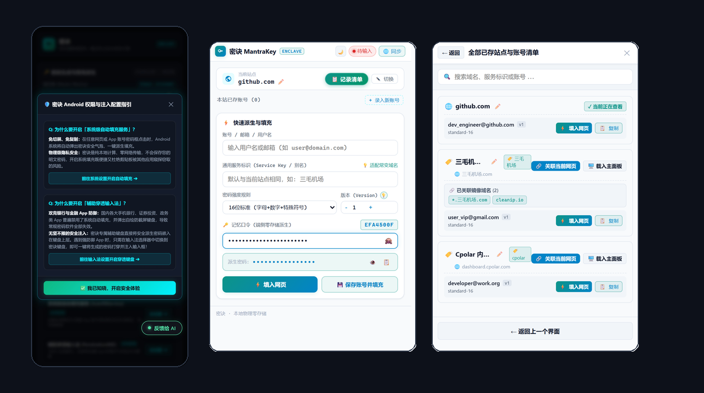
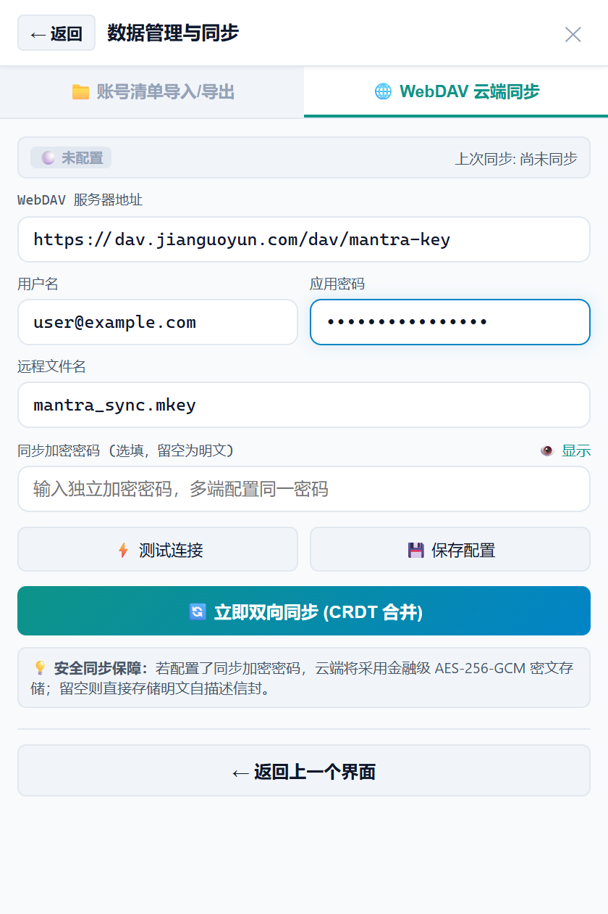
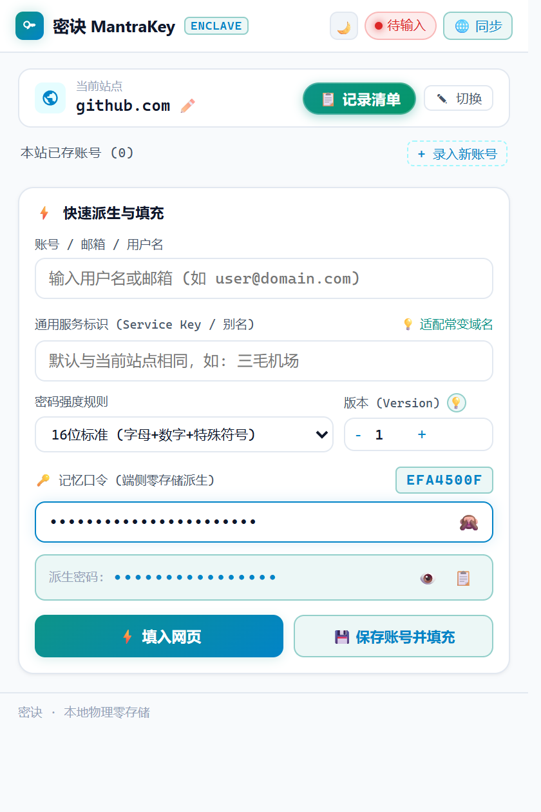
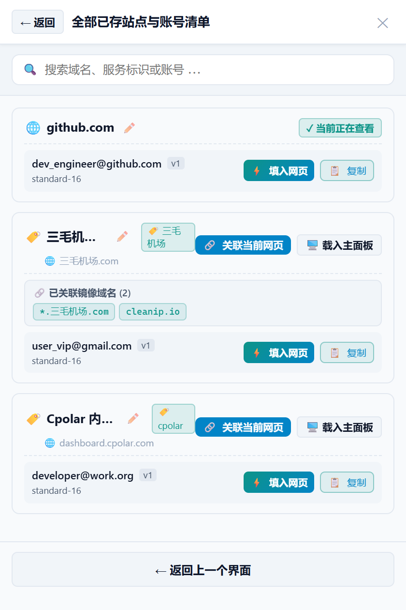
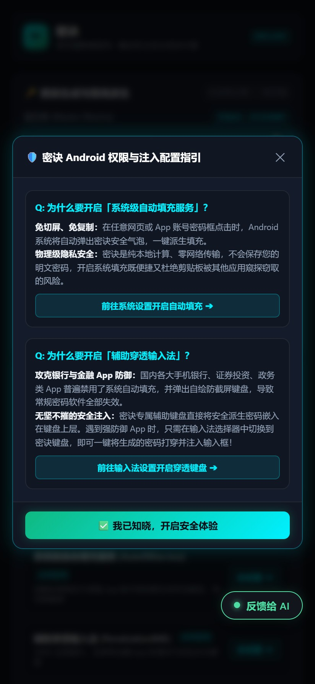

<div align="center">

# 密诀 (MantraKey)
### 确定性无状态 · 物理零存储 · 跨端全生态密码引擎

[](https://www.rust-lang.org/)
[](releases/)
[](apps/extension/)
[](crates/mantra-sync/)
[](LICENSE)

<br/>

<p align="center">
  <strong>彻底告别中心化密码库泄露、无惧设备丢失、无数据库可脱、现场纯数学派生。</strong><br/>
  只需铭记唯一主口令，随时随地为每一个站点、每一个账号，精确算出一模一样的强密码。
</p>

<br/>



</div>

---

## 🎯 产品定位：什么是“确定性无状态”密码引擎？

传统的密码管理器（如 1Password、Bitwarden、KeePass 等）本质上是**“保险库模型（Vault Model）”**：它们在本地或云端维护一个集中式的加密数据库（包含你所有的明文账号、网址与密码密文），一旦遇到系统漏洞、弱主密码被爆破或服务商被脱裤，密码库中的全部凭据便面临毁灭性泄露。

**密诀（MantraKey）颠覆了这一范式，采用“现场纯数学确定性派生架构（Deterministic Stateless Derivation Engine）”：**

1. **零存储（Zero-Storage）**：磁盘上**不保存任何站点密码**，也没有集中式的密码数据库。任何黑客或木马即使物理拿到你的设备，也无法在磁盘中找到哪怕一段密码密文。
2. **纯计算（Pure Computation）**：密码是通过公开规范的密码学散列链与拒绝采样算法，基于 `主口令 + 站点域名 + 账号名 + 版本号 + 规则规格` **现场实时运算而成**。
3. **确定性（Deterministic）**：相同的输入必然在毫秒级内产生完全相同的强密码。换言之，**你的大脑记忆就是全世界唯一的密码备份**；只要记住主口令，在任何一台全新安装的电脑或手机上，立刻就能“无中生有”算出一模一样的密码。
4. **内存 15 分钟自毁**：主口令仅驻留于安全内存 Enclave 中，超时或手动点击立即进行物理字节覆盖擦除（`Zeroize`），绝不在持久化存储中留下蛛丝马迹。

---

## ⚡ 核心解决的痛点问题

| 传统痛点场景 | 传统密码库弊端 | 密诀 (MantraKey) 的破局方案 |
| :--- | :--- | :--- |
| **云端保管库泄露风险** | 如 LastPass 多次被脱裤，黑客离线批量撞库弱哈希主密码。 | **无库可脱**：服务端与本地均不存在密码库，从物理机制上杜绝密码库外泄可能。 |
| **主口令误输入引发错误** | 输入长口令时手抖错敲 1 个字母，导致派生出完全错误的密码而浑然不知。 | **独创“金丝雀防手抖校验指纹（Canary Fingerprint）”**：实时基于 HMAC 计算 8 位特征码，比对指纹即可百分之百确信未敲错。 |
| **手机银行/金融 App 禁用填充** | 证券、银行、政务 App 强制自绘密码安全键盘、禁用系统 Autofill 并拦截粘贴板。 | **自研“穿透式输入法（PenetrationIME）”**：直接在系统键盘层集成派生引擎，100% 击穿任何第三方 App 的防填充限制。 |
| **跨设备同步隐私外泄** | 将密码上传至第三方服务商云端，被迫信任厂商的安全承诺。 | **去中心化 WebDAV E2EE 零知识多端同步**：仅同步域名规则清单，使用 AES-256-GCM 本地加密打包为 `MK` 密文，远端只能看到二进制乱码。 |
| **多设备并发修改冲突** | 在手机上改了密码版本，又在电脑上新增了账号，同步时旧版本覆盖新版本。 | **状态型无冲突复制数据类型（CvRDT）**：全端实现数学级 LWW 时间戳与单调递增版本决胜算子，无损自动双向合并。 |

---

## 🚀 核心架构亮点与功能特性

### 1. 独创“金丝雀防手抖校验指纹” (Canary Verification Fingerprint)
在无状态派生体系中，最大的心理焦虑是：“我刚才主口令有没有打错某个字母？”
- 密诀在内存中使用独立的密码学生成不可逆的 8 位大写十六进制指纹（如 `A6FAA80B`）；
- 输入主口令时实时计算，无需看到密码明文，只需眼角余光扫一眼熟悉的 8 位指纹，即可百分之百确保主口令输入绝对精确无误；
- 指纹绝不暴露任何可还原主口令的熵值，既消除击键焦虑，又守卫极致安全。

### 2. 全端对齐的 WebDAV 端到端零知识同步 (E2EE + CvRDT)
<div align="center">
  
</div>

- **统一二进制加密信封 (`mantra_sync.mkey`)**：
  采用 `[MK 标志位 (2B)] + [版本号 (1B)] + [Salt (16B)] + [IV (12B)] + [Ciphertext + Tag (16B)]` 黄金封包结构；
- **强密码学保护**：本地采用 `PBKDF2-HMAC-SHA256 (100,000次迭代)` 派生加密主密钥，对称采用 `AES-256-GCM` 认证加密；
- **零知识云端存储**：可直接托管于个人的**坚果云、Nextcloud、群晖/威联通 NAS、WebDAV 容器**，服务端仅存二进制密文；
- **状态型无冲突合并 (CvRDT)**：站点规则集双向合并，采用毫秒级最后写入胜出（LWW）与账号版本递增，支持软删除墓碑防旧数据复活。

### 3. Chrome MV3 原生沉浸式扩展 (WXT 驱动)
<div align="center">
  
  &nbsp;&nbsp;
  
</div>

- **纯正原生 Action Popup**：极致组件化倒角体系与 `#0b0f17` Obsidian 暗夜配色，杜绝白边闪烁与页面跳出；
- **自适应 Header 状态栏**：未解锁时展示紧凑的 `🔴 待输入` 与 `🌐 同步`，输入口令后展示实时计算的 `8位金丝雀防敲错指纹` 与 15 分钟会话守卫；
- **智能域名、别名与关联池**：支持通过 ✏️ 别名设置通俗名称（如将 `dash.xxx.com` 设为 `三毛机场`），支持「🔗 关联当前网页」将多域名镜像收拢至同一账号；
- **在线静默热重载升级**：内置 Native 代理一键更新服务，点击「⚡ 一键更新」原地自动热升级。

### 4. Android 双引擎：系统级填充 + 辅助穿透输入法 (PenetrationIME)
<div align="center">
  
</div>

- **标准 AutofillService**：深度适配 Android 8.0+ 框架，当光标进入网页或常见 App 账号密码框时，自动触发系统悬浮浮窗一键计算填充；
- **自研穿透输入法 (PenetrationIME)**：针对银行、证券、政务、数字人民币等强制使用“自绘防录屏随机软键盘”而彻底拦截系统填充的金融类 App，密诀提供独立的辅助穿透键盘。在键盘工具栏中一键调起派生引擎，直接向输入连接发送安全按键事件，**100% 击穿任何防填充壁垒**；
- **硬件生物识别**：支持系统指纹与人脸解锁，免去频繁重复输入长口令的繁琐。

### 5. PC 桌面端 HUD 极速唤起 (Rust + Tauri + Obsidian Dark UI)
- 基于 Rust 跨端核心与 Tauri 轻量级渲染，全局快捷键秒级呼出 HUD 悬浮操作面板；
- 底层直接调用操作系统辅助功能 API 与虚拟按键注入通道，实现全系统窗口无缝模拟击键。

---

## 🏗️ 代码工程全景矩阵

```text
mantra-key/
├── apps/
│   ├── android/              # Android 原生应用 (Kotlin + Vue/Vite + PenetrationIME 穿透键盘)
│   ├── desktop/              # PC 桌面端 HUD (Rust + Tauri + Obsidian 暗黑主题)
│   ├── extension/            # Chrome MV3 浏览器扩展 (WXT + TypeScript + WebDAV E2EE)
│   └── native-proxy/         # PC 本地进程通信与原生消息代理
├── crates/
│   ├── mantra-crypto/        # 核心密码学库 (PBKDF2、拒绝采样算法、金丝雀指纹、Zeroize 内存擦除)
│   ├── mantra-sync/          # WebDAV E2EE 封包规范与 CvRDT 状态型无冲突合并算子
│   ├── mantra-identity/      # 规范化域名清洗、Punycode 还原与单点登录 (SSO) 联邦映射
│   ├── mantra-plugin/        # 安全插件运行时与 WebAssembly 沙箱机制
│   └── mantra-e2e/           # 全平台端到端黄金向量 (Golden Vectors) 集成测试套件
└── releases/                 # 预编译分发目录 (Android Debug / Release APK 及校验和)
```

---

## 📦 快速下载、安装与使用

> 📖 **完整详尽的操作指引请查阅：[《密诀 (MantraKey) 用户使用与安装配置手册》](docs/USER_GUIDE.md)**

所有官方预编译产物均可在 GitHub 仓库的 **[Releases](https://github.com/lylyuanliang/mantra-key/releases)** 页面一键下载：

| 客户端形态 | 分发文件名称 | 核心特性与亮点 |
| :--- | :--- | :--- |
| **Chrome / Edge 扩展** | `mantra-key-chrome-extension-v0.1.0.zip` | MV3 原生弹窗、多域名关联、网页自动填充、内置 Native 在线静默热更新 |
| **Android 手机端** | `mantra-key-v0.1.0-release.apk` | 纯净精简构建 (5MB)、系统级 Autofill、独创穿透输入法 (PenetrationIME) |
| **Windows 桌面端** | `mantra-key-desktop-v0.1.0-windows-x64.zip` | Rust + Tauri 轻量中枢、全局快捷键秒级呼出 HUD 悬浮面板、Native 代理桩 |

### 快速安装 3 步走（以浏览器扩展为例）：
1. **下载解压**：下载扩展 ZIP 包解压至本地固定工具目录（如 `D:\Tools\MantraKey`）；
2. **加载扩展**：浏览器进入 `chrome://extensions`，开启右上角「开发者模式」，点击「加载已解压的扩展程序」，选择该目录；
3. **开启在线自动更新（仅需一次）**：在解压目录中双击 **`启用自动更新.bat`** 即可！以后插件发现新版时，点击面板「⚡ 一键更新」即可原地静默热重载升级。

---

## 🛠️ 快速上手与编译构建指南

### 环境准备
- **Node.js**: 20+ (推荐 Node 22 或 24)，并配置 `pnpm 9+`
- **Rust**: 1.80+ (`cargo` 编译工具链)
- **JDK**: 17+ 及 Android SDK (用于编译移动端)

### 1. 运行核心库单元测试
```bash
# 运行 Rust 密码学与同步库的全部 48 项测试
cargo test --workspace

# 验证浏览器扩展核心算法与契约测试
pnpm --filter @mantra-key/extension test
```

### 2. 编译 Chrome 浏览器扩展
```bash
# 进入工程根目录安装依赖
pnpm install

# 构建 Chrome MV3 生产产物
pnpm --filter @mantra-key/extension build

# 产物位于 apps/extension/.output/chrome-mv3
# 打开 Chrome -> 扩展程序 (chrome://extensions) -> 开启开发者模式 -> 加载已解压的扩展程序
```

### 3. 构建 Android 移动端 APK
```bash
# 通过项目内置的自动化脚本一键编译并签名 APK
powershell -ExecutionPolicy Bypass -File scripts/build_android.ps1 -NoPause

# 编译完成后，输出位于 releases/ 目录：
# - mantra-key-v0.1.0-debug.apk   (调试版)
# - mantra-key-v0.1.0-release.apk (发布签名版)
```

---

## 🛡️ 核心安全论证：清单泄露 + 源码全公开，为何密码依然无法反推？

许多用户最关心的安全假设是：**“如果攻击者拿到了我的记录清单（Manifest），且工具源码是 100% 开源的，对方是否能反推出我的主口令，或者推导出我其他网站的密码？”**

**答案是：数学上绝对不可能。这完全符合现代密码学著名的【柯克霍夫原则（Kerckhoffs's principle）】——系统的安全性必须且仅依赖于密钥（主口令）的保密，而不依赖算法的保密。**

### 1. 记录清单中到底存了什么？（核心安全边界）
- 密诀的记录清单中**绝不存储主口令**，也**绝不存储最终生成的密码明文**；
- 清单中保存的仅仅是**派生元数据（Metadata）**：`域名 (domain)`、`用户名 (username)`、`密码规则 (standard-16)` 与 `版本号 (version)`；
- 这些元数据只是数学函数中的“已知参数”，而最核心的“自变量与主根密钥”（主口令）**只存在于用户的大脑中**。没有主口令，整个派生公式根本无法启动。

### 2. 单向陷门函数（One-Way Function）的不可逆性
密诀的密码派生严格遵循密码学单向哈希链：
$$\text{Master Seed} = \text{PBKDF2-HMAC-SHA256}(\text{Master Mantra}, \text{Global Salt}, 100000)$$
$$\text{Site Entropy} = \text{HMAC-SHA256}(\text{Master Seed}, \text{domain} \parallel \text{username} \parallel \text{version})$$
$$\text{Password} = \text{RejectionSampling}(\text{Site Entropy}, \text{Charset}, \text{Length})$$

- 根据 SHA-256 的**抗原像性（Pre-image Resistance）**与**抗第二原像性**，从已知的输出（即使黑客通过网站脱库拿到了某个站点的密码明文），在数学上**无法逆向推导出哈希输入**（Master Seed 或 Master Mantra）。
- 这就像用机器将土豆压成了土豆泥，即使机器的机械图纸（源码）公开、放进去的葱花配料（清单元数据）公开，也不可能把土豆泥反向拼回完整的生土豆。

### 3. 域隔离（Domain Separation / Key Isolation，拒绝跨站连环撞库）
- 每个站点的输入均被域名隔离，在密码学上作为伪随机函数（PRF）的独立输入；
- **各站点密码在统计学上是相互独立的（Statistically Independent）**。即使某一个小论坛被脱裤泄露了派生密码，黑客也**绝对无法**推算该用户在 Google、GitHub 或银行网站上的密码，彻底切断了传统密码连环撞库的链条。

### 4. 抵抗离线暴力枚举的极高算力成本（Key Stretching）
- 拥有源码和清单后，黑客唯一的攻击路径是对主口令进行**离线暴力穷举（Brute-force Attack）**；
- 密诀采用了高达 **100,000 次 PBKDF2 迭代**的密钥拉伸机制。即使使用算力顶级的 GPU 矿机集群，每次猜测口令的计算成本都被放大了十万倍；
- 只要用户的主口令满足基本熵值（例如 3~4 个随机单词组成的 Passphrase），现代计算机甚至宇宙毁灭前的时间尺度都无法完成爆破。

---

## 🔄 核心机制解析：为什么必须引入“版本号 (Version)”？

“既然相同的主口令 + 相同的域名，算出的密码永远是一模一样的，那为什么还要引入版本号？”

这是无状态密码系统解决**“密码轮换（Password Rotation）”**的唯一优雅解法：

1. **现实业务痛点**：
   - 很多企业内网、银行或网站强制要求：**“每 90 天必须修改一次密码，且新密码不能与旧密码相同”**；
   - 站点出现安全漏洞报警，需要紧急修改密码；
   - 密码曾临时告诉他人，事后需要更换。
2. **如果没有版本号会发生什么？**
   - 算法是确定性的，相同输入必定产出相同密码；
   - 用户如果要改密码，改主口令？会导致全世界上百个网站的密码全变；改域名？破坏了自动填充。
3. **版本号的作用：单个站点的“密码轮换旋钮”**：
   - 当需要修改密码时，用户只需在密诀中将该账号的版本号由 `1` 调整为 `2`（点击 `+` 号）；
   - 输入参数变为 $\text{version}=2$，算法立即现场派生出一个**全新的、与旧密码完全统计独立的高强度强密码**；
   - 既保持了“零存储、确定性”（下次输入 version=2 依然能准确算出该新密码），又实现了极其便捷的单站点按需轮换！

---

## 🔒 密码学与安全规范声明

- **核心哈希标准**：PBKDF2-HMAC-SHA256，全平台默认迭代轮数固定为 `100,000` 次；
- **字符映射算法**：拒绝采样（Rejection Sampling），绝无取模偏差（Modulo Bias），满足等概率真随机分布；
- **信封对称加密**：AES-256-GCM（96-bit Nonce + 128-bit 认证标签）；
- **内存安全标准**：主口令仅驻留内存，会话超时或主动锁定时执行物理覆写擦除；
- **无中心化存储**：服务端永不持有用户的私钥，亦不参与任何明文解密与计算过程。

---

## 📄 开源许可证

本项目基于 [MIT 许可证](LICENSE) 开源。欢迎提交 Issue 与 Pull Request 共同构建次世代无状态安全网络！
